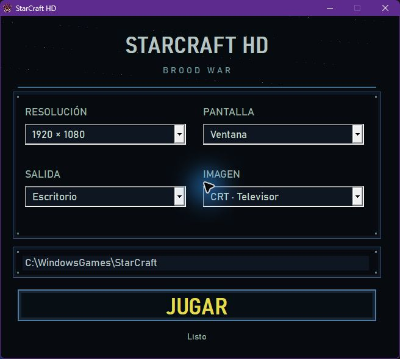
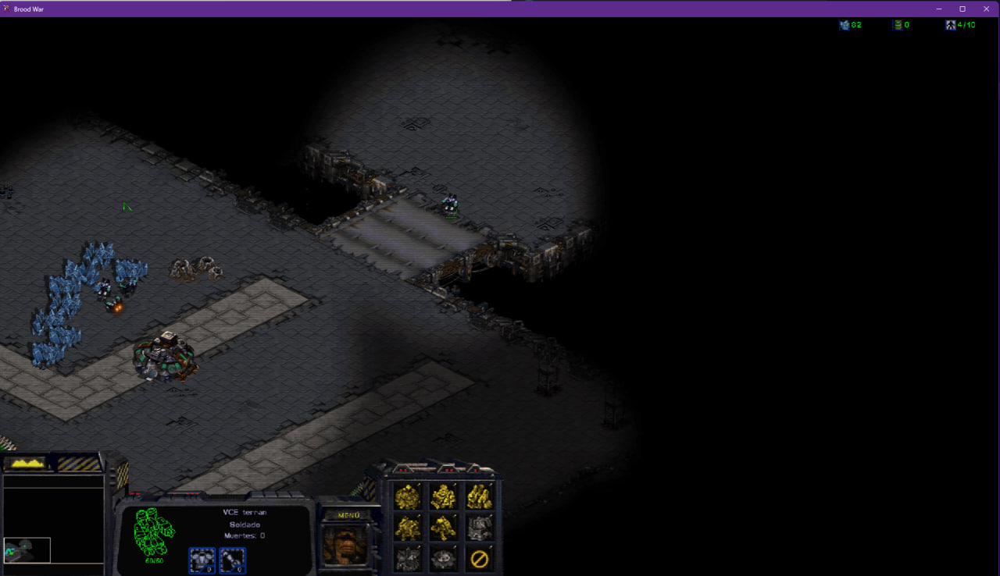
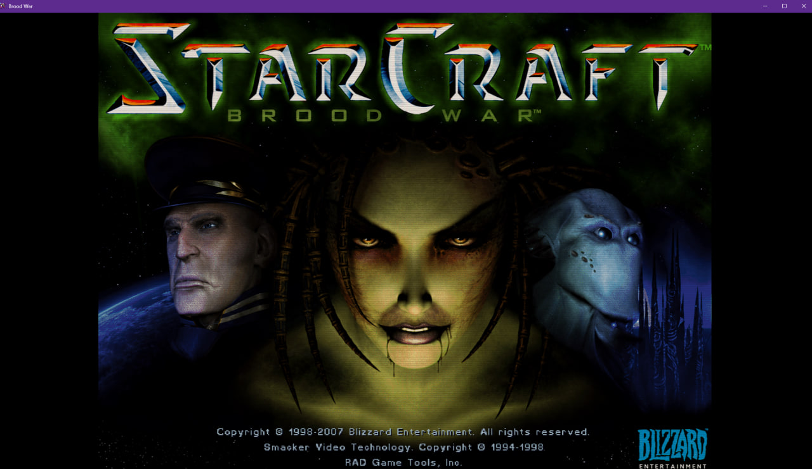

# StarCraft HD

Launcher y parche para **StarCraft y Brood War 1.16.1 en Windows**.
Permite jugar en resoluciones modernas conservando el aspecto clásico.

[Descargar StarCraft HD](https://github.com/jcarlosab/parches/raw/refs/heads/main/Starcraft/downloads/StarCraft-HD.zip)

## Instalación

1. Descarga y extrae **StarCraft-HD.zip**.
2. Copia su contenido a la carpeta donde está `StarCraft.exe`, incluida la carpeta `filters`.
3. Abre **StarCraft-HD.exe**, elige resolución, pantalla y filtro, y pulsa **JUGAR**.

Necesitas una instalación propia de StarCraft 1.16.1. El paquete no incluye el juego
ni requiere instalar Rust. Los ajustes se guardan automáticamente.
Mantén el launcher abierto durante la partida: al cerrar el juego restaura la
configuración gráfica anterior. Usa el parche en partidas individuales sin conexión.

## Mejoras

- Resoluciones internas de 960×540 a 1920×1080, además del modo original 640×480.
- Menú principal ampliado al alto de la ventana y centrado, manteniendo las proporciones.
- Barra completa a la izquierda, con arte de Terran, Zerg o Protoss y tamaño del 150 % a 1080p.
- Recursos ampliados a la derecha con fondo transparente; terreno visible junto a la barra.
- Menú de pausa y ventanas de partida ampliados al 150 %, con clics ajustados.
- Ayudas emergentes al 200 %.
- Filtros de píxel nítido, suavizado, CRT de televisor y monitor de tubo de PC.
- Pantalla inicial mejorada con IA, con el texto de carga original y fondo preparado una sola vez.

El parche se aplica en memoria y no modifica `StarCraft.exe` en disco.

## Imágenes

### Launcher

### Partida

### Pantalla inicial

## Archivos

`StarCraft-HD.exe`, `sc_resolution.dll`, `ddraw.dll` y `filters/` deben permanecer juntos.
`launcher.ini` contiene los ajustes; `launcher.log` y `rust-resolution.log` permiten
consultar errores. No borres `session-backup` si contiene un archivo `ready`:
vuelve a abrir el launcher con el juego cerrado para recuperar la configuración.

Créditos y licencias: [LICENCIAS.txt](LICENCIAS.txt). StarCraft y Brood War son marcas
de Blizzard Entertainment. Este proyecto es un parche no oficial.
